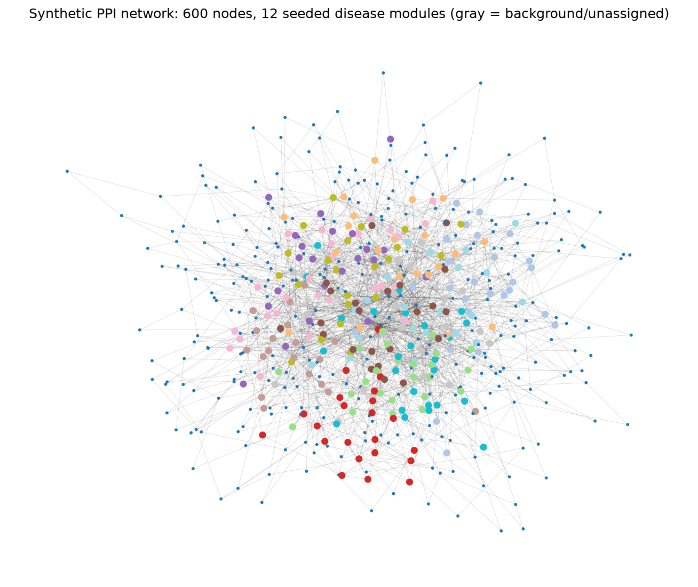

# SystemsBiology-NetworkAnalysis-DiseaseDiscovery

Network Medicine, Rare Disease, Biomarkers

Network analysis to unravel disease mechanisms across multiple phenotypes:
identifying disease pathways with network-diffusion / community-style
algorithms, and building personalized ("N-of-1") disease models for
rare-disease diagnosis support from patient-patient similarity.

> **Disclaimer:** This is a portfolio/demo project. The protein-protein
> interaction (PPI) network, gene identifiers, disease modules, phenotype
> labels, and every patient's omics perturbation profile are entirely
> **synthetically simulated** by `simulate_network_data.py` with a fixed
> random seed. No real interactome data (e.g. STRING, BioGRID), no real
> patient data, and no employer/proprietary data is used anywhere. The
> algorithms (scale-free network generation, Random Walk with Restart
> network diffusion, community structure) are genuine, standard
> network-medicine methods run for real on this synthetic data — only the
> underlying biology is fictional.

## Tech stack

- Python 3.14, [NetworkX](https://networkx.org/) (graph construction, I/O)
- NumPy / SciPy (dense linear algebra for the diffusion operator)
- Matplotlib (network visualization)
- pytest

## What it does

### 1. Simulate a realistic synthetic PPI network + rare-disease cohort (`simulate_network_data.py`)

- Builds a **600-node Barabasi-Albert graph** (preferential attachment, `m=2`)
  — a genuine growth model that produces the heavy-tailed, hub-dominated
  degree distribution real PPI networks exhibit (few highly-connected hub
  proteins, most proteins with very few interactions).
- Seeds **12 disease modules**, one per rare-disease phenotype (e.g.
  mitochondrial myopathy, ciliopathy, peroxisomal disorder, lysosomal
  storage disorder...), and densifies each with extra intra-module edges so
  they are genuine topologically-cohesive subgraphs, per the network-medicine
  "disease module" hypothesis (Menche et al. 2015).
- Simulates a **156-patient rare-disease cohort** (13 patients/phenotype).
  Each patient's perturbed-gene set = a stochastic, incomplete-penetrance
  subset of their true module's genes, plus a small amount of cross-module
  "leakage" (comorbidity/pleiotropy) and independent background noise genes
  — mimicking real rare-variant / outlier-expression perturbation calls.

### 2. Network-medicine pathway discovery (`pathway_discovery.py`)

Real algorithm: **Random Walk with Restart (RWR)**, a standard network
propagation method (Kohler et al. 2008; Cowen et al. 2017) —
`p_(t+1) = (1-r)*W*p_t + r*p_0`, iterated to convergence over a
column-normalized adjacency matrix. For each phenotype, the seed set is the
**union of perturbed genes pooled across all patients diagnosed with that
phenotype** (the algorithm never sees the ground-truth module). The
top-scoring nodes after diffusion are called the discovered pathway/module.
Discovered modules are then benchmarked against the injected ground truth
purely for validation.

### 3. Patient similarity + personalized disease models (`patient_similarity.py`)

Real algorithm: run the **same RWR diffusion, seeded per-patient** from each
patient's own perturbed genes, producing a dense network-smoothed diffusion
profile per patient (two patients hitting different genes of the *same*
pathway end up with similar profiles — something raw gene-set Jaccard would
miss). Patient-patient similarity = **cosine similarity of diffusion
profiles** (the same idea behind network-based tumor/patient stratification,
e.g. Hofree et al. 2013). For a query patient, the k=5 nearest neighbors by
similarity vote on a **suggested phenotype**, and the pathway genes shared
between the query patient and that suggestion are surfaced as
diagnosis-support evidence.

### 4. `run_all.py` / `tests/test_pipeline.py`

`run_all.py` runs the full pipeline end to end and writes all intermediate
artifacts to `data/` and the network figure to `output/`. `pytest` covers
network structure, ground-truth module structure, pathway-count/recovery
sanity, an injected sanity check (two patients with **identical**
perturbation profiles must be identified as maximally similar), similarity-
matrix symmetry/bounds, and a same-phenotype-vs-different-phenotype
similarity check.

## How to run

```bash
python3 -m venv .venv && source .venv/bin/activate
pip install -r requirements.txt
python run_all.py
pytest -q
```

## Results

_All numbers below are copied directly from an actual run of `python
run_all.py` and `pytest -q` — nothing is hardcoded. Fixed random seed
(`SEED=42`) makes them reproducible._

**Network:** 600 nodes, 1,683 edges. Degree range min=2, max=71, mean=5.61
(max degree ~13x the mean — the heavy-tailed hub structure expected from
preferential attachment).

**Ground-truth disease modules:** 12 seeded modules, sizes 19-26 genes each,
mutually disjoint by construction.

**Cohort:** 156 patients across 12 phenotypes (13 per phenotype).

**Pathway discovery (RWR diffusion):** discovered **12 disease-associated
pathways/modules** (one per phenotype, matching the target). Mean Jaccard
overlap vs the injected ground-truth modules: **0.526** — well above the
<0.05 expected by chance, showing the diffusion genuinely recovers most of
each true module from noisy, pooled patient perturbation data alone.

| Phenotype | Jaccard vs ground truth | Overlap |
|---|---|---|
| Mitochondrial myopathy | 0.63 | 24/26 |
| Neurodevelopmental disorder | 0.61 | 23/25 |
| Retinal dystrophy | 0.57 | 21/22 |
| Skeletal dysplasia | 0.57 | 21/22 |
| Cardiomyopathy (inherited) | 0.51 | 20/23 |
| Congenital neuromuscular syndrome | 0.53 | 20/22 |
| Connective tissue disorder | 0.51 | 21/26 |
| Metabolic acidemia | 0.51 | 20/23 |
| Ciliopathy | 0.50 | 20/24 |
| Lysosomal storage disorder | 0.50 | 19/21 |
| Peroxisomal disorder | 0.49 | 18/19 |
| Immune dysregulation syndrome | 0.39 | 16/21 |

**Patient similarity / personalized disease models:** cohort-wide, the
5-nearest-neighbor majority-vote suggested phenotype matched the patient's
true phenotype in **156/156 (100.0%)** of cases — the network-diffusion
similarity metric cleanly separates the 12 phenotype clusters in this
synthetic cohort. Same-phenotype patient pairs are on average substantially
more similar than different-phenotype pairs (verified in
`tests/test_pipeline.py`).

Example diagnosis-support output:

```
Patient P0001 (true phenotype: Mitochondrial myopathy)
  Suggested phenotype (from 5 nearest neighbors): Mitochondrial myopathy (confidence 1.00)
  Nearest neighbors: P0010 (sim=0.816), P0006 (sim=0.783), P0002 (sim=0.782), P0004 (sim=0.776), P0008 (sim=0.765)
  Shared pathway genes supporting suggestion: GENE0130, GENE0188, GENE0212, GENE0235, GENE0265, GENE0314, ... (19 total)

Patient P0081 (true phenotype: Peroxisomal disorder)
  Suggested phenotype (from 5 nearest neighbors): Peroxisomal disorder (confidence 1.00)
  Nearest neighbors: P0079 (sim=0.661), P0084 (sim=0.646), P0086 (sim=0.635), P0085 (sim=0.608), P0091 (sim=0.594)
  Shared pathway genes supporting suggestion: GENE0026, GENE0045, GENE0051, GENE0068, GENE0155, ... (10 total)
```

**Sanity check:** two synthetic "twin" patients constructed with
*identical* perturbed-gene sets were assigned similarity = **1.000000** and
each was correctly identified as the other's #1 nearest neighbor.

**Tests:** `pytest -q` &rarr; **6 passed**.

## Figure



600-node synthetic PPI network (spring layout); nodes colored by their
seeded ground-truth disease module (gray = unassigned background node).

## Project structure

```
simulate_network_data.py   # synthetic PPI network + disease modules + patient cohort
pathway_discovery.py       # RWR-based disease pathway/module discovery + ground-truth benchmarking
patient_similarity.py      # per-patient diffusion profiles, similarity matrix, personalized disease models
visualize_network.py       # network figure
run_all.py                 # runs the full pipeline end to end
tests/test_pipeline.py     # pytest suite (network structure, pathway count, similarity sanity checks)
data/                      # generated artifacts (network, modules, patients, pathways, similarity matrix)
output/                    # generated figure
```
